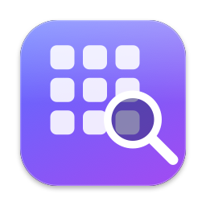

<p align="center">
  
</p>

<h1 align="center">MacAppLauncher</h1>

<p align="center"><a href="README.md">English version</a></p>

Un petit lanceur d'apps pour macOS, rapide, qui **ne dépend pas de Spotlight**.

## Pourquoi

Raycast, Alfred, le Launchpad et Spotlight demandent tous à l'index Spotlight la liste des apps installées. Quand cet index casse (c'est arrivé après certaines mises à jour de macOS, avec un `mds_stores` qui plante en boucle sur une base corrompue), les apps disparaissent de tous les lanceurs. La seule réparation est alors une réindexation complète, qui peut prendre une heure.

MacAppLauncher liste lui-même les `.app` des dossiers d'applications. Il trouve environ 300 apps en 150 ms, les garde en mémoire et surveille les dossiers. Pas d'index, rien à reconstruire.

## Fonctionnalités

- **Raccourci global** : `⌥ Espace` par défaut, modifiable depuis la barre des menus.
- **Recherche instantanée** : comparaison en mémoire, moins d'1 ms par frappe.
- **Correspondance intelligente** : début du nom, puis initiales (`ws` → WebStorm), début de mot, puis lettres dans l'ordre. Les accents sont ignorés.
- **Apprend tes habitudes** : les apps lancées souvent remontent en tête.
- **Tout au clavier** : `↑ ↓` pour choisir, `↩` pour ouvrir, `⌘1` à `⌘9` pour ouvrir directement un résultat, `⎋` pour effacer puis fermer.
- **Garde la dernière recherche** : à la réouverture, elle est présélectionnée. Taper la remplace, `↩` relance l'app.
- **Toujours à jour** : la liste se met à jour quand une app est installée ou supprimée.
- **Liquid Glass** : panneau en verre natif de macOS 26.
- **Léger** : environ 55 Mo de mémoire, aucune dépendance, vit dans la barre des menus.
- **Lancement à l'ouverture de session** : un clic dans le menu.

### Dossiers parcourus

| Dossier | Contenu |
|---|---|
| `/Applications` (et sous-dossiers) | Tes apps |
| `/System/Applications` | Apps Apple, Utilitaires |
| `/System/Cryptexes/App/System/Applications` | Safari |
| `/System/Library/CoreServices/Applications` | Utilitaires système |
| `~/Applications` | Apps de l'utilisateur, web apps Chrome et Safari |

## Installation

Télécharger l'image disque depuis la [dernière release](https://github.com/dimer47/MacAppLauncher/releases/latest), puis glisser MacAppLauncher dans Applications. L'app est signée et notarisée.

**Prérequis** : macOS 26 ou plus récent.

## Utilisation

| Action | Comment |
|---|---|
| Ouvrir la recherche | Raccourci global, ou relancer l'app |
| Changer le raccourci | Icône de la barre des menus → *Modifier le raccourci…* → taper la combinaison |
| Lancer à l'ouverture de session | Icône → *Lancer à l'ouverture de session* |
| Forcer un nouveau scan | Icône → *Rescanner les apps* |

Si le raccourci est déjà pris par une autre app (ChatGPT utilise aussi `⌥ Espace`), une alerte demande d'en choisir un autre.

## Compiler depuis les sources

```sh
git clone https://github.com/dimer47/MacAppLauncher.git
cd MacAppLauncher
./build.sh                # compile, signe, installe dans /Applications et lance
./build.sh --no-install   # compile et signe seulement, dans build/
./build.sh --notarize     # notarise aussi (profil de trousseau « notary »)
```

La signature utilise un certificat Developer ID. Pour en changer : `SIGN_IDENTITY=<sha1 ou nom> ./build.sh`, ou `SIGN_IDENTITY=-` pour une signature locale.

Mesurer la réactivité à la frappe :

```sh
BENCH=1 .build/release/MacAppLauncher
```

L'icône est dessinée par du code : `swift tools/make-icon.swift <sortie.iconset>`, puis `iconutil -c icns`.

## Organisation du projet

| Fichier | Rôle |
|---|---|
| `Sources/MacAppLauncher/AppScanner.swift` | Scan des dossiers, surveillance, correspondance |
| `Sources/MacAppLauncher/SearchPanel.swift` | Panneau en verre, liste, clavier |
| `Sources/MacAppLauncher/HotKey.swift` | Raccourci global (Carbon, sans autorisation Accessibilité) |
| `Sources/MacAppLauncher/main.swift` | Délégué de l'app, barre des menus, saisie du raccourci |
| `build.sh` | Compilation, bundle, signature, notarisation, installation |
| `.github/workflows/` | Compilation à chaque poussée, release signée sur tag |

## Publier une version

Pousser un tag : `git tag v1.1.0 && git push origin v1.1.0`. Le workflow *Publication* compile, signe, notarise et publie un `.dmg` dans les Releases GitHub.

Secrets du dépôt nécessaires : `MAC_CERT_P12`, `MAC_CERT_PASSWORD`, `APPLE_ID`, `APPLE_APP_SPECIFIC_PASSWORD`.

## Licence

GPL-3.0, voir [LICENSE](LICENSE).
